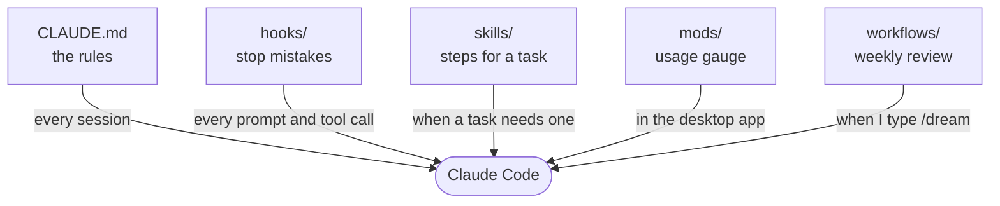

My setup and how I work with it, made public so you can borrow from it. Most of it stops a mistake
Claude Code makes again and again before it happens, and every commit quotes the prompts behind it
in [`PROMPTS.md`](PROMPTS.md).



**Docs:** [how it works](docs/how-it-works.md), [what you get](docs/what-you-get.md), [how I
work](docs/how-i-work.md), [my Mac](docs/mac.md), [evals](docs/evals.md),
[install](docs/install.md). New here? Paste this into Claude Code:

```text
clone github.com/zululima/setup into ~/Projects and help me pick what to install
```

[CC BY-SA 4.0](LICENSE-CC-BY-SA-4.0): `CLAUDE.md`, `PROMPTS.md`, `docs/`, `SKILL.md` files, this
README. [AGPL-3.0-or-later](LICENSE): the rest.
