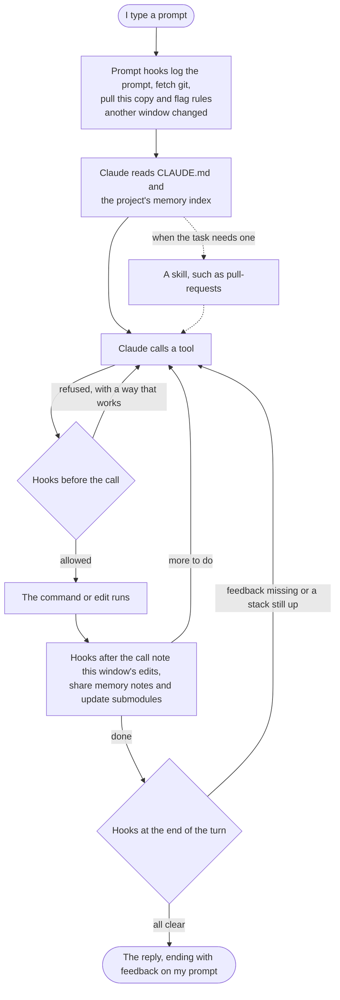
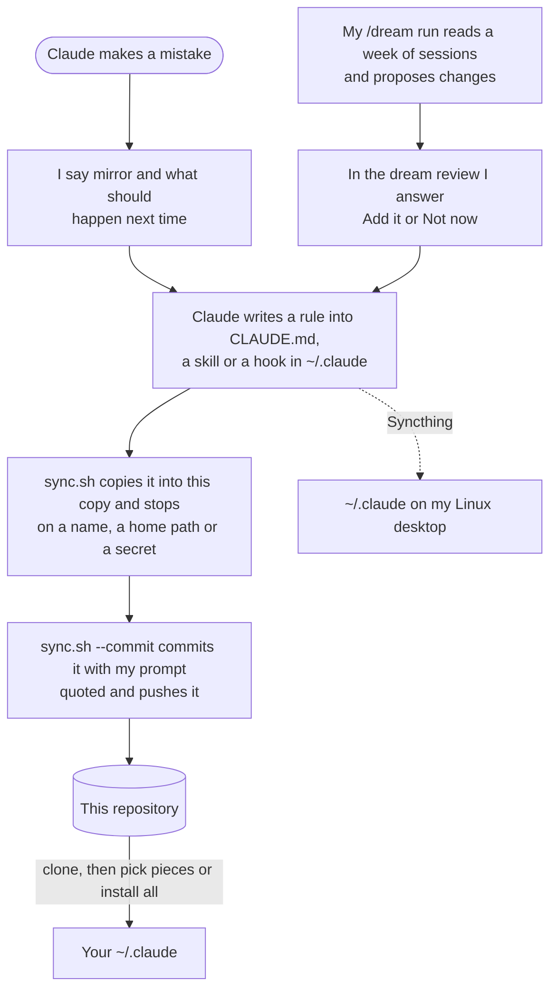

# How it works

Claude Code reads `~/.claude` when a session starts and at set moments while it runs. This
repository is a copy of the parts other people can use.

| Part | When Claude Code reads it | What it does |
| --- | --- | --- |
| [`CLAUDE.md`](../CLAUDE.md) | every session, from the start | the rules Claude follows in every project |
| [`settings.json`](../settings.json) | every session, from the start | turns the hooks and mods on, picks the model, allows and blocks tools |
| [`hooks/`](../hooks) | at set moments: a prompt, before and after each tool call, the end of a turn | stops a mistake before it happens, or hands Claude a fact it would miss |
| [`skills/`](../skills) | only when a task needs one | the steps for one kind of work, such as a pull request |
| memory | each project's index every session, a note when it applies | what one project taught Claude, kept per project folder |
| [`mods/`](../mods) | always, in the desktop app | a gauge under the prompt, and archived sessions' files moved away |
| [`workflows/dream.js`](../workflows/dream.js) | when I type `/dream` | reads a week of sessions and proposes changes |

## One prompt

What happens between typing a prompt and reading the reply:

A hook that refuses a call tells Claude why and what to run instead, so Claude tries again the right
way rather than stopping. [What you get](what-you-get.md) lists every hook and what it stops.

## How a rule gets in

Many rules here started as a mistake Claude made:

[`sync.sh`](../sync.sh) also runs in the background at every prompt, so a change pushed from one
computer reaches the other. Every commit quotes the prompts behind it, and
[`PROMPTS.md`](../PROMPTS.md) collects them. [Install](install.md) shows how to take pieces or all
of it.
