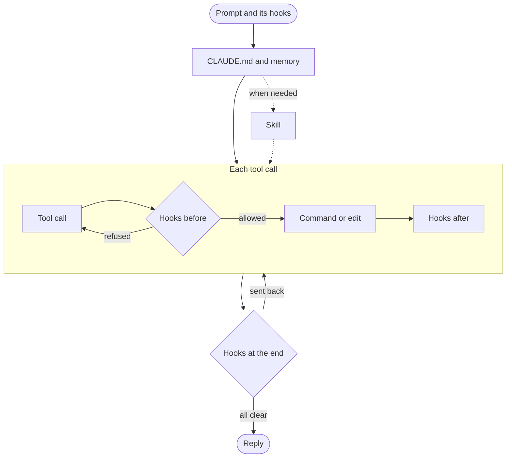
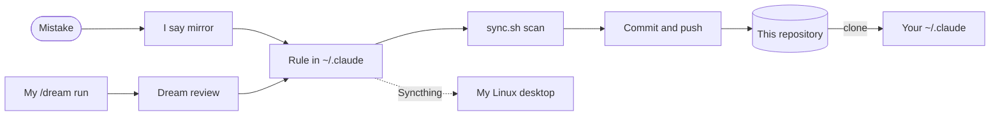

# How it works

Claude Code reads `~/.claude` when a session starts and at set moments while it runs. This
repository is a copy of the parts other people can use.

| Part | When Claude Code reads it | What it does |
| --- | --- | --- |
| [`CLAUDE.md`](../CLAUDE.md) | every session, from the start | the rules Claude follows in every project |
| [`settings.json`](../settings.json) | every session, from the start | turns the hooks and mods on, picks the model, allows and blocks tools |
| [`hooks/`](../hooks) | at set moments: a prompt, before and after each tool call, the end of a turn | stops a mistake before it happens, or hands Claude a fact it would miss |
| [`skills/`](../skills) | only when a task needs one | the steps for one kind of work, such as a pull request |
| memory | each project's index every session, a note when it applies | what one project taught Claude, kept per project folder |
| [`mods/`](../mods) | always, in the desktop app | a gauge under the prompt, and archived sessions' files moved away |
| [`workflows/dream.js`](../workflows/dream.js) | when I type `/dream` | reads a week of sessions and proposes changes |

## One prompt

What happens between typing a prompt and reading the reply:

- Prompt hooks log the prompt, fetch git, pull this copy and tell Claude when another window changed
  the rules.
- Claude reads `CLAUDE.md` and the project's memory index, and loads a skill, such as
  `pull-requests`, only when the task needs it.
- Hooks before each tool call refuse a mistake, and tell Claude why and what to run instead, so it
  tries again the right way rather than stopping.
- Hooks after each call note this window's edits, share memory notes and update submodules.
- Hooks at the end of the turn send it back once when the feedback on my prompt is missing or a
  stack Claude started is still up.

[What you get](what-you-get.md) lists every hook and what it stops.

## How a rule gets in

Many rules here started as a mistake Claude made:

- I say `mirror` and what should happen next time, or `/dream` reads a week of my sessions and I
  answer Add it or Not now to each change it proposes.
- Claude writes the rule into `CLAUDE.md`, a skill or a hook in `~/.claude`, and Syncthing carries
  it to my other computer.
- [`sync.sh`](../sync.sh) copies it here and stops on a name, a home path or a secret. With
  `--commit` it commits the change with my prompt quoted and pushes it, and
  [`PROMPTS.md`](../PROMPTS.md) collects those prompts. It also runs in the background at every
  prompt, so a change pushed from one computer reaches the other.
- You clone this repository and take pieces or all of it, as [install](install.md) shows.
